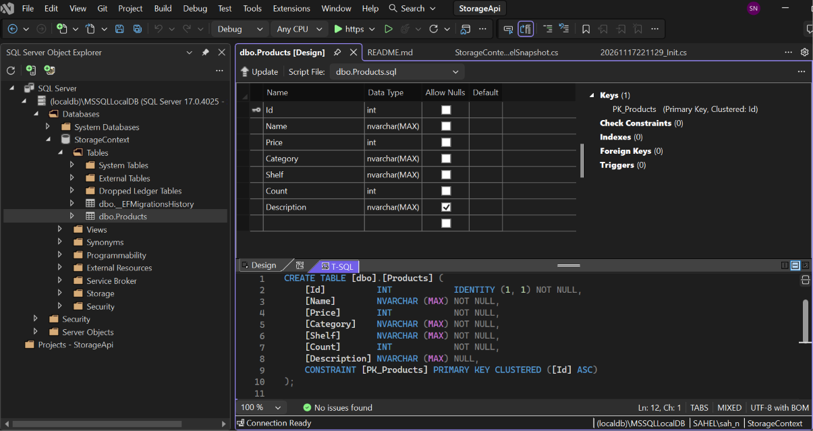
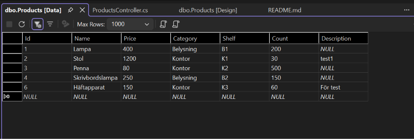
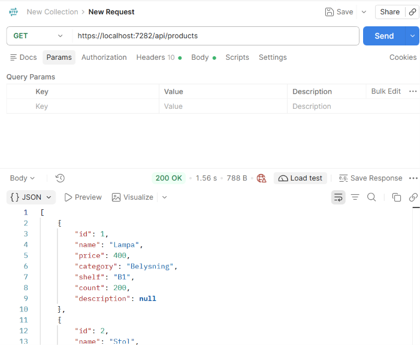
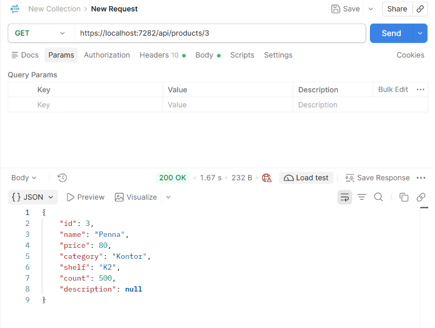
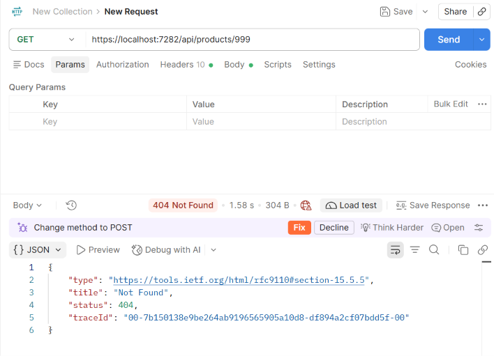
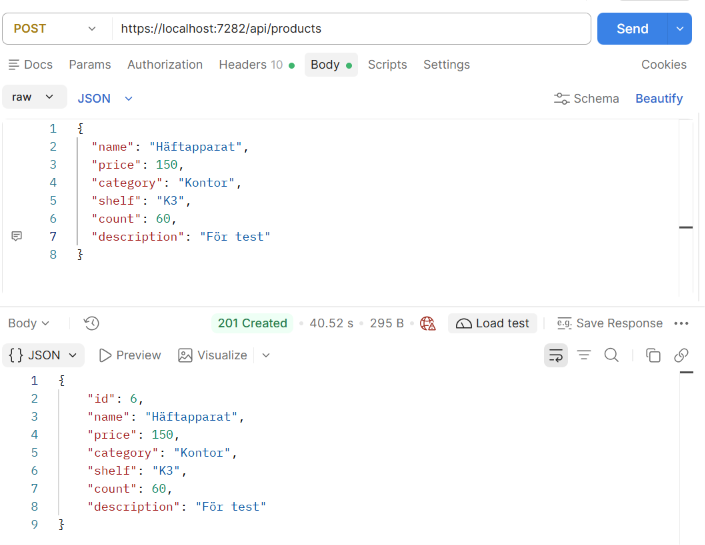
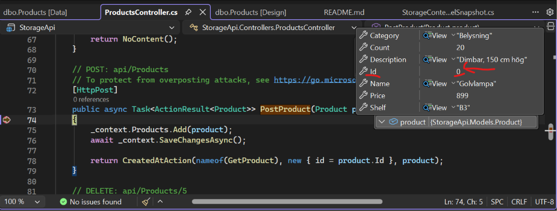

# API – Övning 1: Lagersystem (StorageApi)

ASP.NET Core Web API (.NET 10) med Entity Framework Core och SQL Server (LocalDB). API:et hanterar produkter i ett lager med full CRUD via `/api/products`.

## Struktur

| Mapp/fil | Innehåll |
|---|---|
| `Models/Product.cs` | Entiteten Product (Id, Name, Price, Category, Shelf, Count, Description) |
| `Data/StorageContext.cs` | DbContext med `DbSet<Product> Products` |
| `Controllers/ProductsController.cs` | Scaffoldad API-controller med CRUD |
| `Migrations/` | Migrationen `Init` som skapar tabellen `Products` |

## Git-arbetsflöde
Varje del gjordes i en egen feature-gren som mergades till `main` via pull request:
- `feature/model-storage` – modellen (Del 2)
- `feature/controller-storage` – controller och DbContext (Del 3)
- `feature/migration-database` – migration och databas (Del 4)

## Del 4 – Migration och databas
Jag körde `Add-Migration Init` och `Update-Database` i Package Manager Console. EF skapade databasen `StorageContext` med tabellerna `Products` och `__EFMigrationsHistory`. Sedan lade jag in några produkter manuellt.

## Del 5 – Efter scaffold

### Vilka metoder har genererats?

| Metod | HTTP | Route | Svar |
|---|---|---|---|
| `GetProduct()` | GET | `/api/products` | 200 OK med alla produkter |
| `GetProduct(int id)` | GET | `/api/products/{id}` | 200 OK, eller 404 om den inte finns |
| `PutProduct(int id, Product product)` | PUT | `/api/products/{id}` | 204 NoContent, 400 om id inte matchar, 404 om den inte finns |
| `PostProduct(Product product)` | POST | `/api/products` | 201 Created |
| `DeleteProduct(int id)` | DELETE | `/api/products/{id}` | 204 NoContent, eller 404 |
| `ProductExists(int id)` | – | privat hjälpmetod | används av PUT |

### Hur används StorageContext?
`StorageContext` registreras i `Program.cs` med `AddDbContext` och `UseSqlServer`, med connection-strängen från `appsettings.json`. Den är scoped, vilket betyder en ny instans per HTTP-anrop. Controllern får den via constructor injection.

`_context.Products` motsvarar tabellen `Products`. EF översätter anropen till SQL: `ToListAsync()` blir en SELECT, `FindAsync(id)` en SELECT med WHERE, och `Add`/`Remove` ändrar bara i minnet tills `SaveChangesAsync()` skickar INSERT/UPDATE/DELETE till databasen.

### Hur fungerar CreatedAtAction, Ok, NotFound osv?
Det är hjälpmetoder i `ControllerBase` som returnerar ett HTTP-svar med rätt statuskod:
- `Ok(x)` – 200. När en metod returnerar `ActionResult<T>` räcker `return product;`, det blir automatiskt 200.
- `NotFound()` – 404, resursen finns inte.
- `BadRequest()` – 400, felaktigt anrop.
- `NoContent()` – 204, lyckades men inget innehåll att skicka tillbaka.
- `CreatedAtAction(nameof(GetProduct), new { id = product.Id }, product)` – 201, skickar med den nya produkten och en `Location`-header med adressen där den kan hämtas.

### Test i Postman

GET alla produkter – 200 OK:

GET en produkt – 200 OK:

GET en produkt som inte finns – 404 Not Found:

POST ny produkt – 201 Created:

### Debuggning
Jag satte en brytpunkt i `PostProduct` och såg att `product.Id` är 0 innan produkten sparas. Id sätts först av databasen (IDENTITY) när `SaveChangesAsync()` körs, och syns sedan i svaret (201 Created).

