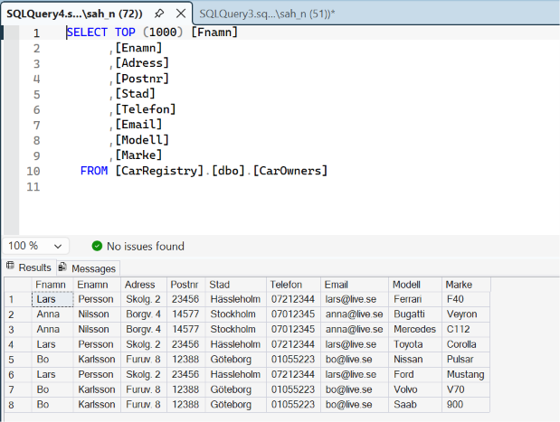
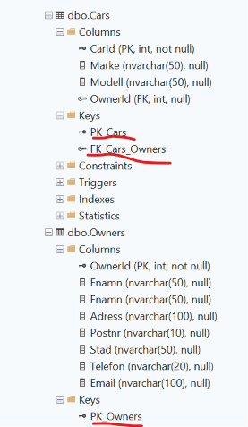
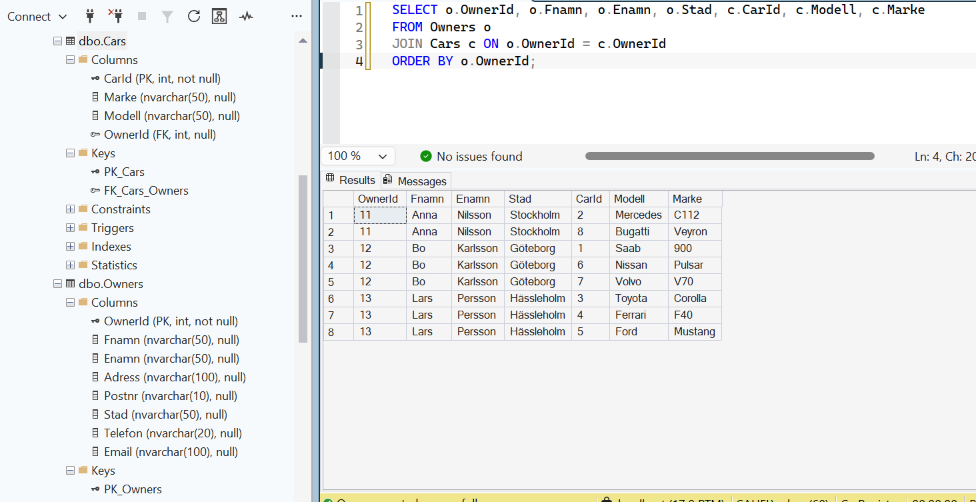

# Databaser – Övning 1

## Uppgift 1

## Uppgift 2
Det är inte bra för att det tar onödig tid att skriva samma sak flera gånger. Man kan också lätt skriva fel, och då blir Bos uppgifter inte samma på alla rader. Om Bo byter telefonnummer måste man ändra på alla hans rader.

## Uppgift 3
För att slippa skriva ägarens uppgifter varje gång delar vi tabellen i två, en för bilägare och en för bilar.

En primärnyckel är ett unikt id för varje rad, till exempel OwnerId i bilägartabellen och CarId i biltabellen. Den gör att varje person och varje bil bara finns en gång och är lätt att hitta.

En sekundärnyckel är en kolumn i biltabellen, till exempel OwnerId, som pekar på primärnyckeln i bilägartabellen. Den visar vilken person bilen tillhör.

Skillnaden är att primärnyckeln identifierar raden i sin egen tabell och måste vara unik, medan sekundärnyckeln kopplar till en annan tabell och kan förekomma flera gånger.

## Uppgift 4
Nej, inte så bra. Personnummer är unikt, men alla har inte ett svenskt personnummer, till exempel turister eller företag som äger bilar. Det kan också ändras, och det är en känslig uppgift som sprids till andra tabeller om den används som nyckel. Det är bättre med ett eget id, till exempel OwnerId.

## Uppgift 5
Nej, sekundärnyckeln behöver inte vara unik. En person kan ha flera bilar, till exempel Bo som har tre bilar. Då står hans OwnerId på tre rader i biltabellen.

## Uppgift 6
Data är bara siffror eller ord, och läsaren vet inte vad de betyder. Information är data med ett sammanhang, så att läsaren förstår vad det är. Till exempel är 01055223 bara data, men "Bo Karlssons telefonnummer är 01055223" är information.

## Uppgift 7
Exempel från en skola med tabellerna Student, Kurs, Lärare och Studentkort:

En till en: varje student har ett studentkort, och varje studentkort tillhör bara en student.

En till många: i den här skolan har varje kurs bara en lärare, men en lärare kan ha flera kurser.

Många till många: en student kan läsa flera kurser, och en kurs kan ha flera studenter.

## Uppgift 8

Jag delade den platta tabellen i två tabeller: Owners med OwnerId som primärnyckel och Cars med CarId som primärnyckel. OwnerId i Cars är en sekundärnyckel som pekar på Owners. Nu finns varje ägare bara en gång, och med en JOIN ser man vilka bilar varje person äger.

