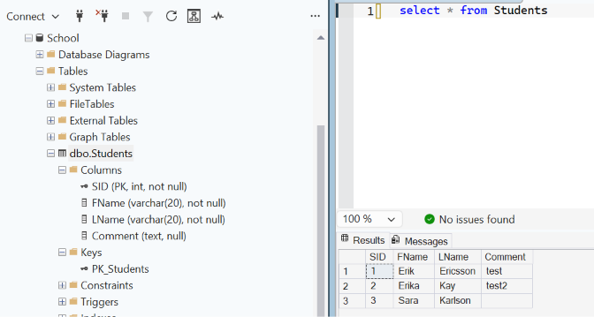

# Databaser – Övning 2

Skapa en databas som heter School med en tabell för studenter och lägg in minst 3 studenter.

| Kolumn | Typ | Måste ha värde? | Primärnyckel? |
|---|---|---|---|
| SID | int | Ja | Ja |
| FName | varchar(20) | Ja | Nej |
| LName | varchar(20) | Ja | Nej |
| Comment | text | Nej | Nej |

## Lösning
Jag skapade databasen School och tabellen Students. SID är primärnyckel, FName och LName är NOT NULL, och Comment får vara tom. Sedan lade jag in 3 studenter.

