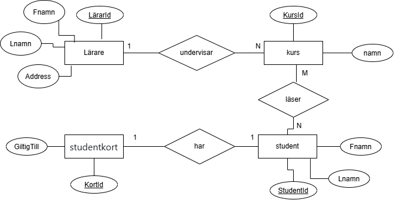

# Databaser – Övning 4: ER-modellering

## Modell 1: Skola
En skola med Lärare, Kurs, Student och Studentkort.

- En lärare undervisar flera kurser, men varje kurs har bara en lärare (en till många).
- En student kan läsa flera kurser och en kurs kan ha flera studenter (många till många).
- Varje student har ett studentkort och varje studentkort tillhör en student (en till en).

