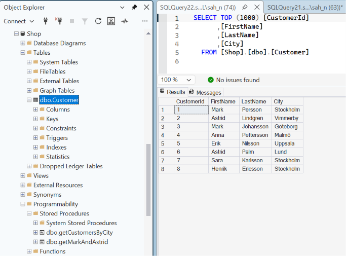
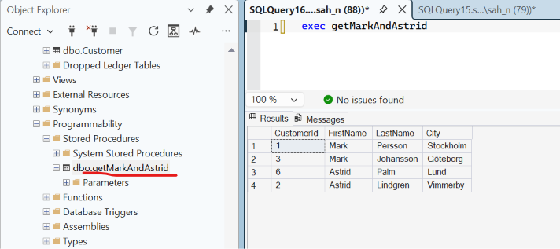

# Databaser – Övning 5: Lagrad procedur

Skapa en lagrad procedur som hämtar ut alla kunder som heter Mark eller Astrid, sorterat fallande på förnamn. Anropa proceduren.

## Lösning

Först skapade jag databasen Shop med tabellen Customer och lade in 8 kunder.



Jag skapade den lagrade proceduren getMarkAndAstrid i databasen Shop och anropade den med EXEC getMarkAndAstrid. Resultatet visar alla kunder som heter Mark eller Astrid, sorterade fallande på förnamn.

```sql
CREATE PROC getMarkAndAstrid
AS
SELECT * FROM Customer
WHERE FirstName = 'Mark' OR FirstName = 'Astrid'
ORDER BY FirstName DESC;

EXEC getMarkAndAstrid;
```

