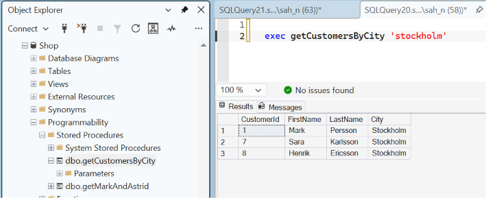
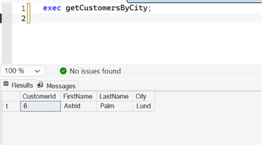
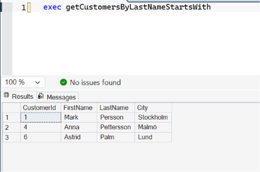

# Databaser – Övning 6: Lagrad procedur

Gör en lagrad procedur som tar en inparameter.
Om man inte anropar med värde ska det finnas ett default värde.

A. Gör en inparameter som är valfri. Kan vara t.ex. namn.
Frågan ska ge ett resultat och namnet på frågan ska spegla vad
det önskade resultatet är.

B. Gör en lagrad procedur som hämtar alla  kunder vars efternamn 
börjar på ’P’ 
Visa även  hur du anropar proceduren

## Lösning A:

Jag skapade den lagrade proceduren getCustomersByCity i databasen Shop och anropade den med EXEC getCustomersByCity 'stockholm'. Resultatet visar alla kunder som bor i Stockholm.

```sql
CREATE PROC getCustomersByCity
    @city NVARCHAR(40) = 'Lund'
AS
SELECT * FROM Customer
WHERE City = @city;

EXEC getCustomersByCity 'Stockholm';
EXEC getCustomersByCity;
```



Jag anropade den också utan parameter, med EXEC getCustomersByCity. Då används defaultvärdet Lund.



## Lösning B:

Jag skapade den lagrade proceduren getCustomersByLastNameStartsWith med en inparameter @letter. Defaultvärdet är 'P', så om man anropar den utan värde får man alla kunder vars efternamn börjar på P. Man kan också skicka in en annan bokstav.

```sql
CREATE PROC getCustomersByLastNameStartsWith
    @letter NVARCHAR(1) = 'P'
AS
SELECT * FROM Customer
WHERE LastName LIKE @letter + '%';

EXEC getCustomersByLastNameStartsWith;        -- default: P
EXEC getCustomersByLastNameStartsWith 'L';    -- med eget värde
```

