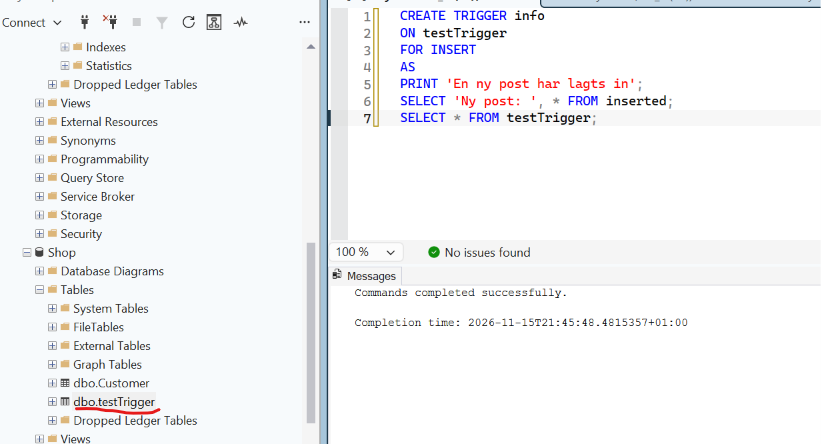
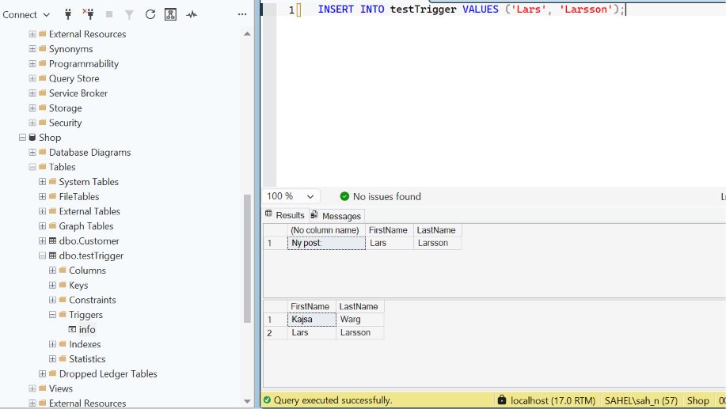
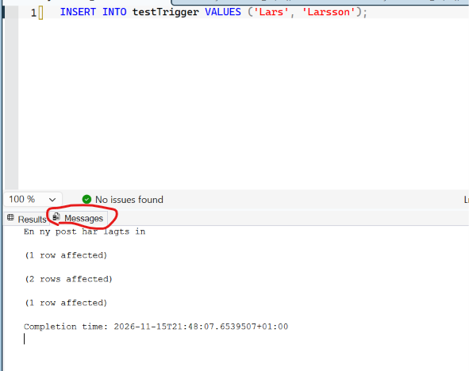
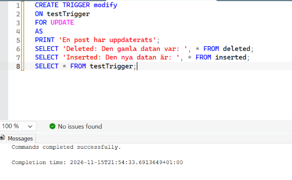
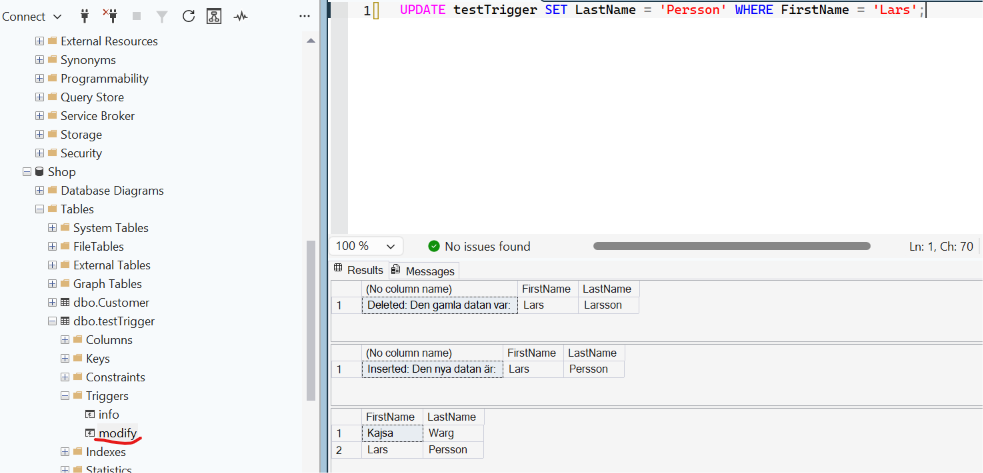
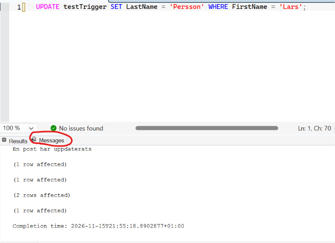
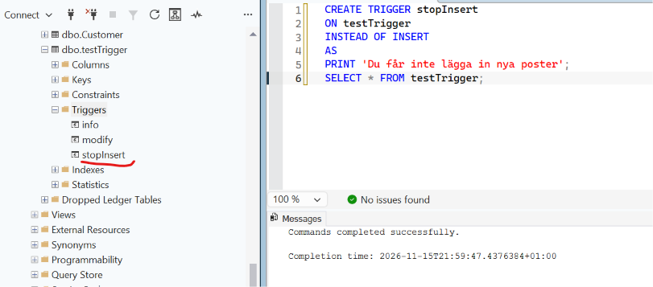
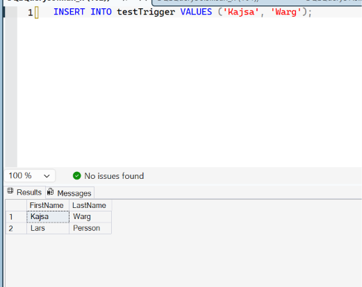
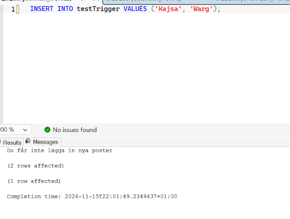

# Databaser – Övning 7: Triggers

Skapa en tabell testTrigger och gör en INSERT-trigger, en UPDATE-trigger och en INSTEAD OF-trigger. Testa att de fungerar.

## Lösning

Jag skapade tabellen i databasen Shop.

```sql
CREATE TABLE testTrigger (
    FirstName VARCHAR(50),
    LastName  VARCHAR(50)
);
```

## 1. INSERT-trigger







## 2. UPDATE-trigger







## 3. INSTEAD OF-trigger






