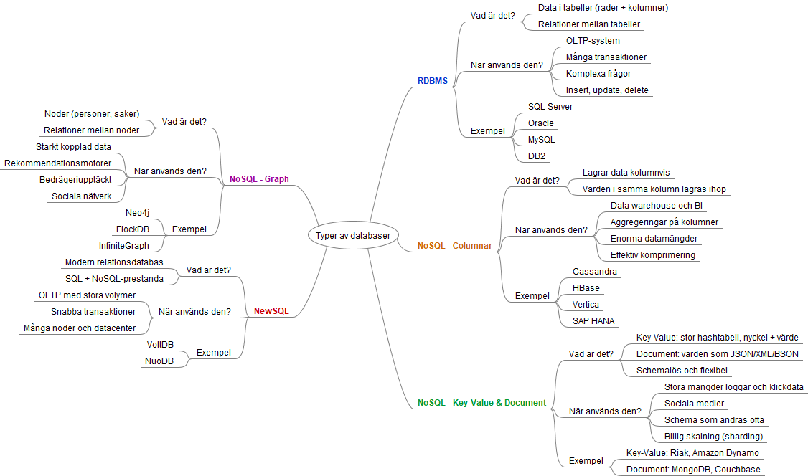

# Databaser – Övning 8: Andra databaser än SQL

Skapa en FreeMind-sida över olika typer av databaser.

## Lösning

Jag gjorde en mindmap i FreeMind över RDBMS, NoSQL (Columnar, Key-Value & Document, Graph) och NewSQL. För varje typ visar jag vad det är, när den används och exempel.

Källfil: [databastyper.mm](databastyper.mm)

